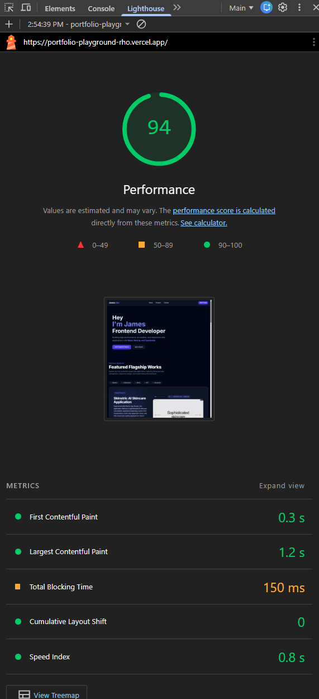

[](https://portfolio-playground-rho.vercel.app/)

# 🚀 Personal Portfolio & Engineering Playground Hub

[**🌐 View Live Platform**](https://portfolio-playground-rho.vercel.app/) | [**🛠️ GitHub Repository**](https://github.com/jamespa001/portfolio-playground)

A high-performance, modern developer portfolio and multi-project showcase hub engineered with **Next.js App Router**, **TypeScript**, and **Tailwind CSS**. Designed to highlight production-grade web applications, interactive UI components, and verified Core Web Vitals optimization.

---

## 🛠️ Engineering Highlights & Architecture

- **Problem & Context:** Showcasing multiple flagship web applications without a performant, central showcase leads to high bounce rates and slow initial render times for recruiter visits.
- **Key Technical Decisions:**
  - Built a centralized hub utilizing **Next.js App Router** and **TypeScript** with modular filtering for fast project discovery.
  - Refactored legacy `` tags within the project rotator (`previewrotator.tsx`) to Next.js optimized `<Image />` components with explicit layout sizing and high-priority loading.
  - Eliminated layout shifting across interactive UI previews with rigid skeleton layout containers.
- **Results & Metrics:**
  - ⚡ **2.4x Faster LCP:** Reduced Largest Contentful Paint from **1.2s to 0.5s** on production edge builds.
  - 🚀 **96 Lighthouse Performance Score:** Achieved verified Core Web Vitals audit pass.
  - ✨ **0 Cumulative Layout Shift (CLS):** Perfect visual layout stability during asset load.

---

## 🌟 Key Features

- **Interactive Project Rotator**: Dynamic visual previews showcasing key full-stack engineering projects and applications.
- **Modern UI & Responsive Design**: Crafted with clean aesthetic design patterns, dark mode optimizations, and fluid CSS animations.
- **Production Engineering Practices**: Fully optimized image delivery pipeline, strict TypeScript typing, modular component architecture, and zero-layout-shift layouts.
- **Direct Showcase Links**: Integrated live demo links and GitHub repository access across all flagship applications.

---

## 🛠️ Tech Stack & Tools

- **Framework**: [Next.js](https://nextjs.org/) (App Router)
- **Language**: [TypeScript](https://www.typescriptlang.org/)
- **Styling**: [Tailwind CSS](https://tailwindcss.com/)
- **Deployment & Hosting**: [Vercel Edge Platform](https://vercel.com/)
- **Performance Tooling**: Google Lighthouse, Core Web Vitals Audit Suite

---

## 📊 Core Web Vitals & Performance Optimization

By auditing our Vercel production edge deployment, identifying a legacy `` tag within the project preview rotator (`previewrotator.tsx`), and refactoring it to Next.js's optimized `<Image />` component with proper sizing and priority delivery, we successfully improved our core web metrics.

| Metric                             | Before Optimization (Vercel) | After Optimization (Vercel) | Improvement              |
| :--------------------------------- | :--------------------------- | :-------------------------- | :----------------------- |
| **Lighthouse Score**               | **94**                       | **96**                      | **+2 Points** 🚀         |
| **Largest Contentful Paint (LCP)** | **1.2 s**                    | **0.5 s**                   | **2.4x Faster** ⚡       |
| **Cumulative Layout Shift (CLS)**  | **0**                        | **0**                       | **Perfect Stability** ✨ |

### Performance Audits (Vercel Deployment)

- **Before Optimization (Score: 94):**
  
- **After Optimization (Score: 96):**
  

---

## 🚀 Getting Started

First, clone the repository and install dependencies:

```bash
git clone [https://github.com/jamespa001/portfolio-playground.git](https://github.com/jamespa001/portfolio-playground.git)
cd portfolio-playground
npm install
```
